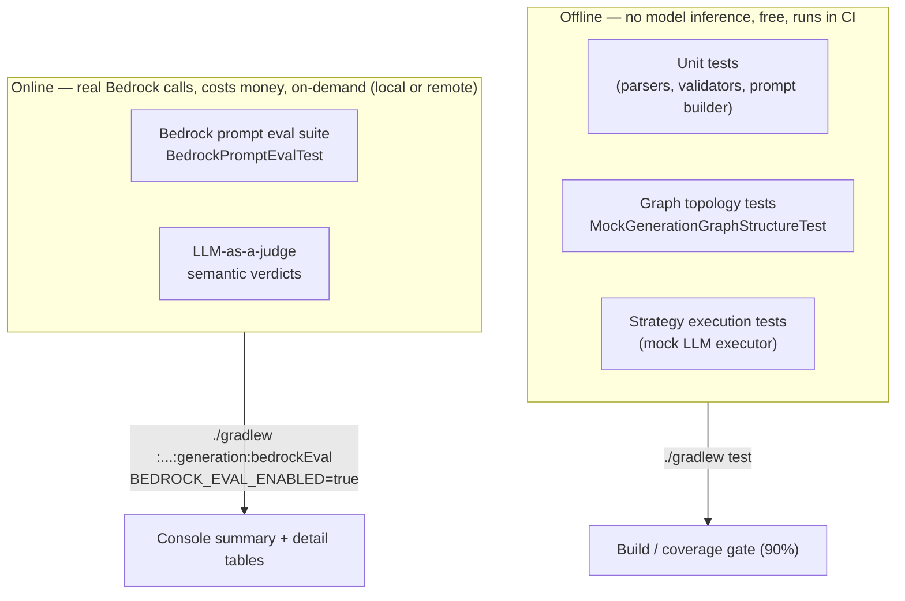
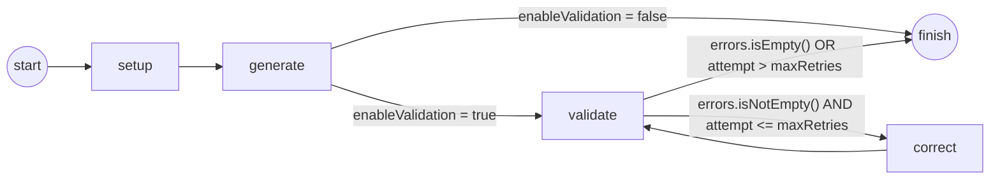
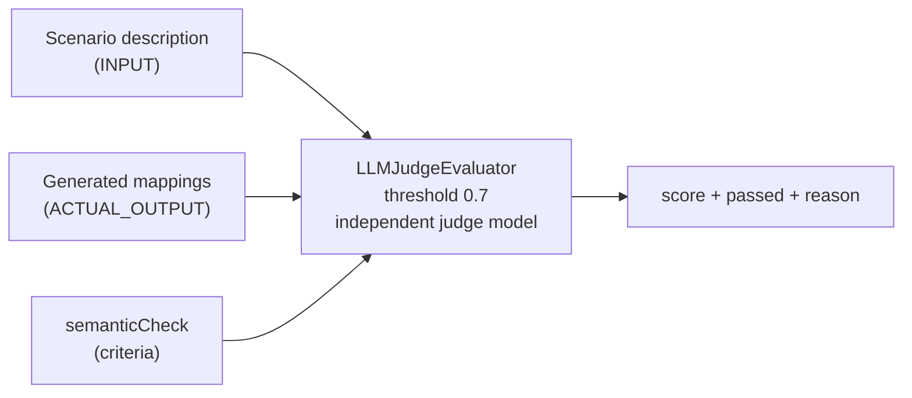

# Testing the AI Mock Generation Agent

This is developer documentation for understanding, running, debugging and extending the tests
around MockNest Serverless' AI mock generation agent. The agent is a [Koog](https://github.com/JetBrains/koog)
graph that turns an API specification plus a natural-language description into WireMock stub
mappings, backed by Amazon Bedrock (Amazon Nova Pro by default).

It is written for any Kotlin/JVM developer, not just for a demo. Each strategy section does,
however, include a short **Conference demonstration** box with a reproducible sequence you can
run on stage (originally prepared for J-Fall) plus a saved-results fallback.

> **Scope note.** This document describes the repository as it exists today and clearly labels
> anything that is a **proposed** change rather than an existing capability. The
> ["Evaluation reporting"](#evaluation-reporting-and-visualization) and
> ["Missing capabilities"](#prioritized-missing-capabilities) sections contain recommendations
> only — nothing in them is implemented yet.

## Contents

- [Testing strategy overview](#testing-strategy-overview)
- [Local setup and AWS credentials](#local-setup-and-aws-credentials)
- [The six testing strategies](#the-six-testing-strategies)
  1. [Graph topology testing](#1-graph-topology-testing)
  2. [Measuring first-pass generation quality](#2-measuring-first-pass-generation-quality)
  3. [Eval-driven prompt improvement](#3-eval-driven-prompt-improvement)
  4. [Testing the correction workflow](#4-testing-the-correction-workflow)
  5. [Calibrating the LLM judge](#5-calibrating-the-llm-judge)
  6. [Evaluating model alternatives](#6-evaluating-model-alternatives)
- [Evaluation reporting and visualization](#evaluation-reporting-and-visualization)
- [CI usage](#ci-usage)
- [Prioritized missing capabilities](#prioritized-missing-capabilities)

---

## Testing strategy overview

The agent is tested at two very different levels, with a deliberate cost/speed boundary between
them.



Key boundary: everything in the **offline** box runs on every `./gradlew test` and in CI, uses a
mock LLM executor (no network, no cost, deterministic). Everything in the **online** box calls
Amazon Bedrock with real specifications, costs a small amount per run, is gated behind the
`bedrock-eval` JUnit tag and the `BEDROCK_EVAL_ENABLED=true` environment variable, and is **not**
wired into any CI workflow.

The online suite is **on-demand**: a developer triggers it explicitly, and it runs the same way
whether that is **local** (your machine) or **remote** (any host with AWS credentials — e.g. a
manually dispatched cloud environment). It is identical in both places because it is just a Gradle
task plus environment variables; "remote" differs only in where the credentials and the JVM live,
not in what runs. No GitHub Actions workflow invokes `bedrockEval` today.

The six strategies documented below map onto this split:

| # | Strategy | Model inference? | Where |
|---|----------|------------------|-------|
| 1 | Graph topology testing | No (mock executor) | `:software:application` |
| 2 | First-pass generation quality | Yes (Bedrock) | `:software:infra:aws:generation` eval |
| 3 | Eval-driven prompt improvement | Yes (Bedrock) | eval + prompt files |
| 4 | Correction workflow | Yes (Bedrock) | eval, retries 0→1 |
| 5 | LLM judge calibration | Yes (Bedrock judge model) | eval datasets |
| 6 | Model alternatives | Yes (Bedrock) | eval, Nova Pro vs Nova Lite |

### The agent under test

`MockGenerationFunctionalAgent` defines a four-node Koog strategy named `"mock-generation"`:



- **setup** — resolves spec content (inline or fetched by URL) and parses it into an
  `APISpecification`.
- **generate** — builds the generation prompt, calls the LLM, parses the response into
  `GeneratedMock`s.
- **validate** — runs the protocol-specific structural validator; records first-pass stats on
  attempt 1.
- **correct** — on validation failure (or parse failure), builds a correction prompt that carries
  the failing mocks and their errors, calls the LLM again, and loops back to validate.

The `validate → correct` versus `validate → finish` decision is governed by `maxRetries` (default
`1`, i.e. two attempts total). This retry boundary is the exact thing the topology tests pin down.

Relevant file: `software/application/src/main/kotlin/nl/vintik/mocknest/application/generation/agent/MockGenerationFunctionalAgent.kt`.

---

## Local setup and AWS credentials

### Prerequisites

- JDK 25 (the build targets JVM 25).
- The Gradle wrapper (`./gradlew`) — no separate Gradle install needed.
- For the offline tests (strategy 1): nothing else. No AWS, no network.
- For the eval suite (strategies 2–6): AWS credentials with Amazon Bedrock access, and the model
  you intend to use enabled in the Bedrock console for your region.

### AWS credentials

The eval tests use the AWS SDK for Kotlin, which reads the standard AWS credential chain. Any of
these work:

- **Shared credentials file** — `~/.aws/credentials` with a `[default]` profile and
  `~/.aws/config` setting `region`.
- **AWS SSO** — `aws sso login --profile <profile>`, then pass `AWS_PROFILE=<profile>`.
- **Environment variables** — `AWS_ACCESS_KEY_ID`, `AWS_SECRET_ACCESS_KEY`, and
  `AWS_SESSION_TOKEN` for temporary/STS credentials.

The default region is `eu-west-1`; override with `AWS_REGION`. The default generation model is
`eu.amazon.nova-pro-v1:0` (resolved from `AmazonNovaPro` with an inference-profile prefix) — it
must be enabled in your Bedrock console.

> The authoritative, always-up-to-date guide to running the eval suite and its environment
> variables is [`docs/PROMPT_EVAL.md`](./PROMPT_EVAL.md). This document references it rather than
> duplicating the full table.

### Cost awareness

The eval suite calls Bedrock for both generation and the LLM judge. A full default run (55 quality
scenarios × 3 iterations) is roughly **$0.66–$1.16**; a single filtered scenario is typically
**$0.01–$0.02**. Always prefer `BEDROCK_EVAL_FILTER` and an explicit `BEDROCK_EVAL_ITERATIONS`
when iterating.

> ⚠️ Before running any eval that calls Bedrock as part of a shared/automated task, get explicit
> confirmation — these calls incur real cost.

---

## The six testing strategies

Each section follows the same shape: **What are we testing**, **How it works**, **Relevant
files**, **How to run it**, **Practical experiment**, **Understanding the results**,
**Reproducibility**, **Troubleshooting**, and (where useful) a compact **Conference
demonstration**.

---

### 1. Graph topology testing

#### What are we testing?

That the agent's strategy graph is wired the way we intend: the expected nodes exist, every node
can reach `finish`, and — most importantly — the `validate → correct → validate` retry loop
honors the `maxRetries` budget exactly.

**Guarantees:** the graph's *shape* and its *routing conditions*. The retry-boundary parameterized
tests prove that for any `maxRetries = N`, `validate` routes to `correct` while there are errors
and `attempt <= N`, and to `finish` as soon as `attempt > N`.

**Limitations:** topology tests say nothing about *output quality*. They use a mock LLM executor
that returns a canned valid response, so they cannot tell you whether a real prompt produces good
mocks, whether validators are correct, or whether Bedrock behaves. They catch accidental rewiring,
off-by-one retry regressions, and unreachable nodes — not generation quality.

#### How it works

The tests use Koog's graph-testing feature (`testGraph`) with `getMockExecutor`, so the strategy
runs without any model inference. The graph assertions are declared inside the `testGraph` block;
the mock collaborators (MockK) and the mock executor exist only so `agent.run(...)` can complete
and trigger verification.

Two kinds of assertions:

- **Node/reachability** — `assertNodeByName(...)`, `assertReachable(a, b)`.
- **Edge routing** — `assertEdges { ... }` with `alwaysGoesTo`, and
  `node withOutput <context> goesTo <target>` to evaluate a specific edge condition against a
  constructed `MockGenerationContext`.

The retry-boundary behavior is checked with a `@ParameterizedTest` + `@CsvSource` table that
varies `(maxRetries, attempt)` and asserts the resulting target (`correct` or `finish`).

#### Relevant files

- Test: `software/application/src/test/kotlin/nl/vintik/mocknest/application/generation/agent/MockGenerationGraphStructureTest.kt`
- Agent/graph under test: `software/application/src/main/kotlin/nl/vintik/mocknest/application/generation/agent/MockGenerationFunctionalAgent.kt`
- Key types: `MockGenerationContext`, `MockGenerationFunctionalAgent.mockGenerationStrategy`

#### How to run it

No AWS, no network, no cost.

```bash
# Just the topology tests:
./gradlew :software:application:test --tests \
  "nl.vintik.mocknest.application.generation.agent.MockGenerationGraphStructureTest"

# Or the whole application module:
./gradlew :software:application:test
```

#### Practical experiment — retry-boundary regression

This demonstrates both a passing state and a deliberately introduced failure, then restores it.

1. **Establish the baseline (green).**
   ```bash
   ./gradlew :software:application:test --tests \
     "nl.vintik.mocknest.application.generation.agent.MockGenerationGraphStructureTest"
   ```
   All tests pass, including the retry-budget parameterized rows such as
   `maxRetries=1, attempt=2 => finish`.

2. **Introduce a specific condition error.** In `MockGenerationFunctionalAgent.kt`, find the
   `validate → correct` edge:
   ```kotlin
   edge(validateNode forwardTo correctNode onCondition { ctx -> ctx.errors.isNotEmpty() && ctx.attempt <= maxRetries })
   ```
   Change the boundary from `<=` to `<`:
   ```kotlin
   edge(validateNode forwardTo correctNode onCondition { ctx -> ctx.errors.isNotEmpty() && ctx.attempt < maxRetries })
   ```
   This silently drops one correction attempt — exactly the kind of off-by-one the tests exist to
   catch.

3. **Rerun and inspect the failing assertion.**
   ```bash
   ./gradlew :software:application:test --tests \
     "nl.vintik.mocknest.application.generation.agent.MockGenerationGraphStructureTest"
   ```
   The parameterized row `maxRetries=1, attempt=1 => correct` now fails: with `<`, attempt 1 no
   longer routes to `correct` (it goes to `finish`), so the `validate withOutput ... goesTo correct`
   assertion fails. The report names the failing `@CsvSource` case.

4. **Restore the original condition** (change `<` back to `<=`) and rerun. The suite is green
   again.

#### Understanding the results

The meaningful assertions are the edge-routing ones. A failure like "expected edge to `correct`
but routed to `finish`" means the retry budget shrank; "node `correct` not reachable" means the
correction loop was disconnected entirely. Because the tests enumerate both the last correcting
attempt and the first attempt past budget for several budgets (0, 1, 2, 3), an off-by-one in
either direction is caught.

#### Reproducibility

These tests are fully deterministic: the mock executor always returns the same canned response,
and the graph is static. No seeds, models, or network involved. Committing the test file is enough
to reproduce.

#### Troubleshooting

- *"Parser not available" / compilation errors in the strategy DSL*: ensure the Koog version in
  `software/application/build.gradle.kts` matches the DSL used (the agent was reviewed against Koog
  0.8.0). No AWS involvement.
- Flakiness is not expected; if a topology test is flaky, suspect a non-deterministic mock
  collaborator setup rather than the graph.

#### Conference demonstration

- **Show on screen:** the strategy graph diagram + the `MockGenerationGraphStructureTest`
  retry-budget `@CsvSource` table.
- **Sequence:** run green → change `<=` to `<` → run red (point at the named failing case) →
  revert → run green.
- **Observation to explain:** a one-character change to a routing condition is invisible to
  execution-level tests but is pinned exactly by the topology table.
- **Fallback:** keep a saved terminal capture of the red run (the named failing parameterized
  case) in case live editing is risky.

---

### 2. Measuring first-pass generation quality

#### What are we testing?

How good the model's output is *before any correction*. First-pass quality is the honest signal of
prompt quality; final (after-correction) success can mask a weak prompt because the correction
retry patches mistakes at extra cost and latency.

**Guarantees:** per-scenario first-pass structural validity, semantic success (via the judge),
latency, token usage and cost, isolated from the correction loop.

**Limitations:** results are non-deterministic (real LLM); single runs vary. Use multiple
iterations to average out borderline scenarios.

#### How it works

`BedrockPromptEvalTest` loads scenarios from a dataset JSON, and for each scenario:

1. Runs the full generation pipeline against Bedrock (parse → prompt → LLM → parse response).
2. Runs the protocol-specific structural validator.
3. Optionally runs the correction retry (controlled by `BEDROCK_EVAL_MAX_RETRIES`).
4. Runs an LLM-as-a-judge semantic check.

Setting `BEDROCK_EVAL_MAX_RETRIES=0` disables correction entirely, so the reported `1st-pass valid`
and `After retry valid` columns are identical and reflect pure single-shot generation. Token usage
is captured by `TokenUsageCapturingClient`, a test-only decorator over the AWS SDK Bedrock client
that reads the `usage` block from each `converse` response; cost is computed by `CostCalculator`.

The agent records first-pass statistics in its result metadata (`firstPassValid`,
`firstPassMocksGenerated`, `firstPassMocksValid`) on attempt 1, which is what the eval reads.

#### Relevant files

- Eval driver: `software/infra/aws/generation/src/test/kotlin/nl/vintik/mocknest/infra/aws/generation/ai/eval/BedrockPromptEvalTest.kt`
- Token capture: `.../ai/eval/TokenUsageCapturingClient.kt`, `.../ai/eval/TokenUsageStore.kt`, `.../ai/eval/TokenUsageRecord.kt`
- Cost: `.../ai/eval/CostCalculator.kt`
- Quality dataset: `software/infra/aws/generation/src/test/resources/eval/multi-protocol-eval-dataset.json`
- First-pass metadata source: `MockGenerationFunctionalAgent.kt` (validate node + `validateNode → nodeFinish` metadata map)

#### How to run it

```bash
BEDROCK_EVAL_ENABLED=true \
BEDROCK_EVAL_MAX_RETRIES=0 \
BEDROCK_EVAL_FILTER=rest-petstore-basic-get \
BEDROCK_EVAL_ITERATIONS=3 \
  ./gradlew :software:infra:aws:generation:bedrockEval --console=plain
```

- `BEDROCK_EVAL_MAX_RETRIES=0` — clean single-shot numbers.
- `BEDROCK_EVAL_FILTER` — case-insensitive substring on the scenario `input` name; keeps cost low.
- `BEDROCK_EVAL_ITERATIONS=3` — averages out variance.

> Note: the `bedrockEval` Gradle task forwards all eval environment variables to the forked test
> JVM — `BEDROCK_EVAL_ENABLED`, `BEDROCK_EVAL_ITERATIONS`, `BEDROCK_EVAL_SUITE`,
> `BEDROCK_EVAL_FILTER`, `BEDROCK_EVAL_MAX_RETRIES`, `BEDROCK_EVAL_DEMO`, `BEDROCK_EVAL_DETAIL`,
> `BEDROCK_JUDGE_MODEL`, `AWS_REGION`, `AWS_PROFILE`, and the AWS credential variables. The task
> also sets `outputs.upToDateWhen { false }` so it always re-runs (env-var and prompt changes are
> not tracked as Gradle inputs), meaning you do not need `--rerun-tasks` between demo iterations.

#### Understanding the results

The console summary and detail tables report, per scenario and per protocol:

- **1st-pass valid** — % of generated mocks that passed structural validation with no correction.
- **After retry valid** — same metric after the correction retry (equal to 1st-pass when retries = 0).
- **Scenario pass** — generation succeeded **and** all mocks valid **and** the semantic judge passed.
- **Gen cost / Judge cost / Total** — Bedrock cost, split by phase.
- **Avg latency** — generation-only wall clock (judge excluded).

A low 1st-pass rate with a high after-retry rate (when retries are on) is the classic signal that
the *prompt* is the weak link, not the pipeline.

#### Reproducibility

- Pin the model (`AmazonNovaPro`), region (`AWS_REGION`), retries (`BEDROCK_EVAL_MAX_RETRIES=0`),
  and iteration count explicitly.
- The dataset JSON and the prompt files under
  `software/application/src/main/resources/prompts/` are the inputs — commit them.
- Save the console output (the summary + detail tables) alongside your change. Existing worked
  examples live in [`docs/prompt-injection-hardening-eval.md`](./prompt-injection-hardening-eval.md)
  and [`docs/soap-realistic-data-stabilization-eval.md`](./soap-realistic-data-stabilization-eval.md).

#### Troubleshooting

- *Test is skipped:* `BEDROCK_EVAL_ENABLED` is not `true`, or the suite assumption skipped it
  (`BEDROCK_EVAL_SUITE`).
- *`AccessDeniedException` / model not enabled:* enable the model in the Bedrock console for your
  region, or switch region.
- *Credentials errors:* confirm the SDK credential chain resolves (profile, SSO session, or env
  vars). The task forwards `AWS_PROFILE` and the AWS credential variables to the forked JVM, so
  setting them in the shell that launches Gradle is enough.
- *Cleanup:* the eval writes nothing to S3 and creates no AWS resources; there is nothing to tear
  down beyond the local Gradle reports under `build/reports/tests/bedrockEval`.

#### Conference demonstration

- **Show on screen:** the per-scenario detail table with `BEDROCK_EVAL_MAX_RETRIES=0` (demo output
  is on by default). With retries = 0 the "After-retry" column is dropped, so first-pass stands
  alone.
- **Sequence:** run one filtered REST scenario, read off the **Valid** / **Semantic** columns and
  latency/tokens/cost.
- **Observation:** first-pass structural validity is the real prompt-quality signal; the Valid and
  Semantic columns show which of the two checks a failure came from.
- **Fallback:** a saved table from a prior run.

---

### 3. Eval-driven prompt improvement

#### What are we testing?

Whether a change to a single prompt node (the REST generation prompt) measurably improves
generation quality, without regressing other scenarios. This is *focused* evaluation of one prompt
file, in contrast to full-flow evaluation across all 55 scenarios and 3 protocols.

#### How it works

The eval harness does not have a separate "node-only" mode — it always runs the real production
pipeline end to end. "Focused" evaluation is achieved by:

- **Filtering scenarios** to the protocol/scenario that exercises the prompt you changed
  (`BEDROCK_EVAL_FILTER`), so the measurement is concentrated on that prompt while still running it
  inside the realistic production context (real parser, real validator, real schema reduction).
- Running a **baseline → change → re-run** comparison.

Can generation prompts be evaluated independently while preserving realistic production context?
**Partially.** You can isolate *which prompt runs* by filtering to scenarios that only touch that
prompt, and the prompt is still exercised through the genuine pipeline (not a stub). What the
harness does **not** support today is evaluating a prompt node against a fixed, captured upstream
context in isolation (e.g. replaying a frozen parsed spec) — every run re-parses and re-reduces the
spec live. For REST this is fine because the REST generation prompt
(`prompts/rest/spec-with-description.txt`) is the dominant variable for REST scenarios.

#### A real REST scenario to demonstrate with

`rest-petstore-consistency` (in `multi-protocol-eval-dataset.json`) is a good candidate: it asks
for cross-referenced data (`GET /pet/1`, `GET /store/order/1` whose `petId` matches the pet's `id`,
and `GET /user/john`). Its semantic check scores 0 if `order.petId` does not match `pet.id`, which
is sensitive to prompt wording around data consistency — exactly what the REST prompt's
consistency bullets target.

#### Relevant files

- REST generation prompt: `software/application/src/main/resources/prompts/rest/spec-with-description.txt`
- REST correction prompt: `software/application/src/main/resources/prompts/rest/correction.txt`
- Scenario + semantic check: `software/infra/aws/generation/src/test/resources/eval/multi-protocol-eval-dataset.json` (`input: rest-petstore-consistency`)
- Eval driver: `.../ai/eval/BedrockPromptEvalTest.kt`

#### How to run it

```bash
# 1. Baseline (no retries, so you measure the prompt, not the corrector):
BEDROCK_EVAL_ENABLED=true BEDROCK_EVAL_MAX_RETRIES=0 \
BEDROCK_EVAL_FILTER=rest-petstore-consistency BEDROCK_EVAL_ITERATIONS=5 \
  ./gradlew :software:infra:aws:generation:bedrockEval --console=plain
```

#### Worked example — fixing `rest-petstore-pagination` live

A clean, reproducible prompt fix suitable for a live demo. Fast run across all petstore scenarios
(1 iteration, one correction retry so you can also show recovery):

```bash
BEDROCK_EVAL_ENABLED=true \
BEDROCK_EVAL_SUITE=quality \
BEDROCK_EVAL_MAX_RETRIES=1 \
BEDROCK_EVAL_ITERATIONS=1 \
BEDROCK_EVAL_FILTER=rest-petstore \
  ./gradlew :software:infra:aws:generation:bedrockEval --console=plain
```

**The failure.** `rest-petstore-pagination` asks for "3 pages of results … use query parameter or
response metadata to distinguish pages." The model adds a `page` query parameter, but the petstore
spec defines no such parameter, and the REST prompt forbids inventing query params. The validator
drops every mock, so the scenario shows `Valid ✗ / Semantic –` (the judge never runs) with:

```
GET /pet/findByStatus: Query parameter 'page' not defined in specification
```

**The fix — `prompts/rest/spec-with-description.txt`, right after line 56** (the "Only use query
parameters that are defined …" rule), add a bullet telling the model what to do *instead*:

```
  - PAGINATION WITHOUT SPEC PARAMS: when the description asks for multiple "pages" of the same
    endpoint but the spec defines no pagination query parameter, do NOT invent one. Emit multiple
    deterministic mappings for that endpoint, each returning a different page of items (unique ids),
    differentiated by `priority`. Never add a `page`, `limit`, or `offset` parameter absent from the spec.
```

The scenario's semantic check explicitly accepts `priority` or distinct URL patterns, so this lets
the model satisfy both the structural validator and the judge.

**Re-run** the same command. `rest-petstore-pagination` should move from `Valid ✗` toward `Valid ✓`
/ `Semantic ✓`. No `--rerun-tasks` needed — the task always re-runs and Gradle reprocesses the
changed prompt resource automatically.

#### Practical experiment — baseline, change, re-run, regression check

1. **Capture the baseline.** Run the command above and record the 1st-pass valid rate and scenario
   pass rate (5 iterations).
2. **Make a targeted prompt change.** In `prompts/rest/spec-with-description.txt`, strengthen the
   consistency guidance — for example make the cross-entity rule more explicit for path-parameter
   IDs. Keep the SECURITY block and output-format rules unchanged.
3. **Re-run the same filtered command.** Compare 1st-pass valid and scenario pass against the
   baseline for `rest-petstore-consistency`.
4. **Check for regressions.** Run a broader REST pass to confirm you did not hurt other scenarios:
   ```bash
   BEDROCK_EVAL_ENABLED=true BEDROCK_EVAL_MAX_RETRIES=0 \
   BEDROCK_EVAL_FILTER=rest BEDROCK_EVAL_ITERATIONS=3 \
     ./gradlew :software:infra:aws:generation:bedrockEval --console=plain
   ```
   Confirm the other REST scenarios hold their pass rates.

#### Understanding the results

A genuine improvement shows up as a higher 1st-pass valid / scenario pass rate for the targeted
scenario across iterations, with no drop elsewhere. Because LLM output varies run to run, treat a
one-iteration swing as noise; look at the averaged rate over several iterations. The existing eval
reports show that some borderline scenarios sit near the judge threshold and flip between runs —
do not over-interpret a single flip.

#### Reproducibility

- Keep the prompt file under version control; the diff *is* the experiment.
- Pin model, region, retries=0, and iteration count.
- Record both the targeted-scenario numbers and the broader REST non-regression numbers, following
  the format of the existing before/after reports in `docs/`.

#### Troubleshooting

- *Filter matched 0 scenarios:* the harness fails fast on a typo'd `BEDROCK_EVAL_FILTER`; the error
  lists available inputs.
- *Noisy results:* increase `BEDROCK_EVAL_ITERATIONS`.
- *Changed the wrong prompt:* REST uses `prompts/rest/`; GraphQL and SOAP have their own prompt
  directories. A REST scenario will not reflect a SOAP prompt change.

#### Conference demonstration

- **Show on screen:** the REST prompt diff and the before/after `rest-petstore-consistency` rows.
- **Sequence:** baseline → edit prompt → re-run filtered → show the delta → quick broad-REST
  non-regression.
- **Observation:** prompt engineering is measurable, and you check for collateral regressions.
- **Fallback:** saved before/after tables.

---

### 4. Testing the correction workflow

#### What are we testing?

The self-correction retry loop: when first-pass validation fails, the agent sends a correction
prompt carrying the failing mocks and their errors, and re-validates. We test the difference
between **first-pass structural validity** and **final workflow success**, and the overhead
(extra LLM call, latency, tokens, cost) the correction adds.

#### How it works

The same `BedrockPromptEvalTest`, run twice: once with `BEDROCK_EVAL_MAX_RETRIES=0` (no correction)
and once with `=1` (one correction attempt, the production default). The reported
`After retry valid` and `attempts` metadata reveal how much the corrector recovered.

In the agent, the `correct` node (`MockGenerationFunctionalAgent.kt`) builds the correction prompt
via `promptBuilder.buildCorrectionPrompt(invalidMocks = ..., specification = ..., format = ...)`.
The correction prompt (`prompts/rest/correction.txt`) receives generation context explicitly: the
**namespace/API name**, a **spec context**, and the **failing mocks paired with their validation
errors** (`{{MOCKS_WITH_ERRORS}}`). It instructs the model to fix every listed error and return
only a JSON array. After correction, the node keeps the already-valid mocks and appends the
corrected ones, increments `attempt`, and loops back to `validate`.

#### Relevant files

- Agent correction node + correction-prompt wiring: `MockGenerationFunctionalAgent.kt`
- Correction prompt: `software/application/src/main/resources/prompts/rest/correction.txt`
- Eval driver (phase-split token/cost capture): `.../ai/eval/BedrockPromptEvalTest.kt`

#### How to run it

```bash
# No correction:
BEDROCK_EVAL_ENABLED=true BEDROCK_EVAL_MAX_RETRIES=0 \
BEDROCK_EVAL_FILTER=rest-petstore-consistency BEDROCK_EVAL_ITERATIONS=3 \
  ./gradlew :software:infra:aws:generation:bedrockEval --console=plain

# One correction retry (production default):
BEDROCK_EVAL_ENABLED=true BEDROCK_EVAL_MAX_RETRIES=1 \
BEDROCK_EVAL_FILTER=rest-petstore-consistency BEDROCK_EVAL_ITERATIONS=3 \
  ./gradlew :software:infra:aws:generation:bedrockEval --console=plain
```

#### Practical experiment — before/after correction

1. Run the retries=0 command; record `1st-pass valid` (= `after-retry` here), latency, tokens, cost.
2. Run the retries=1 command on the same scenario and iterations.
3. Compare: `After retry valid` should be ≥ `1st-pass valid`; `attempts` becomes 2 on scenarios
   that needed correction; generation latency and token/cost rise because of the extra LLM call.
4. Confirm, by reading the logs, that the correction prompt received the failing mocks and their
   errors (the eval logs first-pass validation errors per scenario).

#### Understanding the results

- **First-pass structural validity** answers "did the model get it right the first time?"
- **Final workflow success** (`Scenario pass`) answers "did the agent, including correction,
  ultimately produce valid + semantically correct mocks?"
- The gap between them is the value the corrector adds — and the extra Gen cost / latency is its
  price. A prompt that needs frequent correction is more expensive and slower in production even if
  its final success looks good.

#### Reproducibility

Pin model/region/iterations; vary only `BEDROCK_EVAL_MAX_RETRIES` between the two runs. Save both
tables. The correction prompt file is part of the input set.

#### Troubleshooting

- *No change between 0 and 1 retries:* the scenario already passed first-pass (nothing to correct)
  — pick a harder scenario (e.g. a consistency or error scenario).
- *`attempts` never exceeds 1:* same reason, or validation is disabled.
- Range for `BEDROCK_EVAL_MAX_RETRIES` is 0–2 (values are coerced into that range).

#### Conference demonstration

- **Show on screen:** two detail tables side by side (retries 0 vs 1) for one scenario.
- **Sequence:** run retries=0 → run retries=1 → contrast `1st-pass` vs `after-retry`, and the extra
  cost/latency.
- **Observation:** correction trades money and latency for reliability.
- **Fallback:** saved paired tables.

---

### 5. Calibrating the LLM judge

#### What are we testing?

Whether the LLM-as-a-judge agrees with a human on whether a generated mock satisfies a scenario.
An LLM judge is itself a model and can be wrong — too lenient or too strict — so it must be checked
against human-labelled examples before you trust its verdicts as a quality gate.

#### How it works

For each scenario, `runSemanticJudge` builds a Dokimos `LLMJudgeEvaluator` with:

- the scenario's `semanticCheck` text as the **criteria**,
- `INPUT` (the scenario `description`) and `ACTUAL_OUTPUT` (the generated mappings JSON) as
  evaluation params,
- a **threshold of 0.7**,
- a **judge model independent of the generator** — default `OpenAIGptOss120B` (a first-party
  Bedrock foundation model), overridable via `BEDROCK_JUDGE_MODEL`. Using a different model than
  the Nova Pro generator reduces same-model self-judging bias.

The judge returns a score in `[0.0, 1.0]`; `passed = score >= threshold`. The eval logs
`score`, `threshold`, `passed`, and crucially the judge's **`reason`** (its explanation). That
reason is logged today but is **not** surfaced in the summary/detail tables (see
[reporting](#evaluation-reporting-and-visualization)).



#### The demo: tighten the rubric so the judge catches a real flaw

Scenario: `rest-petstore-basic-get` ("mocks for all GET endpoints"). Nova Pro's output is often
incomplete — it drops `/user/login` and `/user/logout`. A human labels that **FAIL**. With the
original lenient rubric the judge passed it anyway. Tightening the rubric makes the judge FAIL it.
Generator is Nova Pro throughout; judge is the default `OpenAIGptOss120B`.

**Step 1 — run before the fix:**

```bash
BEDROCK_EVAL_ENABLED=true \
BEDROCK_EVAL_SUITE=quality \
BEDROCK_EVAL_CALIBRATE=true \
BEDROCK_EVAL_BODY_PREVIEW=2500 \
BEDROCK_EVAL_MAX_RETRIES=0 \
BEDROCK_EVAL_ITERATIONS=1 \
BEDROCK_EVAL_FILTER=rest-petstore-basic-get \
  ./gradlew :software:infra:aws:generation:bedrockEval --console=plain
```

In the JUDGE DECISION block, note whether login/logout are in the generated endpoints and what the
judge scored.

**Step 2 — edit the rubric.**

- File: `software/infra/aws/generation/src/test/resources/eval/multi-protocol-eval-dataset.json`
- Entry: `"input": "rest-petstore-basic-get"` (near line 336); its `semanticCheck` is the next line (~line 343).
- Replace the whole `semanticCheck` line with:

```
        "semanticCheck": "CONTEXT: Output is a JSON array of WireMock stub mappings; each has 'request' (url/urlPath/urlPathPattern, namespace-prefixed like /petstore-eval/) and 'response' (jsonBody or body). HARD REQUIREMENT (check FIRST): the output MUST contain a GET mock for EVERY one of these 8 endpoints — /pet/findByStatus, /pet/findByTags, /pet/{petId}, /store/inventory, /store/order/{orderId}, /user/login, /user/logout, AND /user/{username}. Go through the list one by one and confirm each URL appears in at least one mock. If even ONE is absent (for example /user/login or /user/logout), the score is 0 — no partial credit, regardless of how good the other mocks are. Then also verify: pet responses include id, name, status; order responses include id, petId, quantity, status; user responses include id, username, firstName, lastName, email; all mocks return HTTP 200; and no mock uses a query parameter undefined in the spec (e.g. username/password on /user/{username}). Score 0 if ANY of the 8 endpoints is missing, if any required field is missing, or if any undefined query parameter is used."
```

**Step 3 — re-run the exact Step 1 command.** No rebuild needed (the dataset is a test resource and
`bedrockEval` always re-runs). The judge now scores **0.00 / FAIL**, its reason listing the missing
endpoints (e.g. "missing mocks for /user/login, /user/logout"). Same output, corrected verdict.

Notes:
- The judge only controls the **Semantic** column; `Valid ✗` (from invented query params) is
  independent and unaffected.
- LLM output varies per run. The fix makes the judge *able* to fail a missing endpoint; it only
  fails when the model actually drops one. If a run generates all 8 endpoints, it legitimately
  passes — rerun to get an incomplete generation, or lower cost by keeping `ITERATIONS=1`.

#### Optional: show the judge model also matters

Swapping the judge model changes verdicts too. With `BEDROCK_JUDGE_MODEL=AmazonNovaLite` (a weaker
judge), the same flawed output is often rubber-stamped PASS even under a strict rubric — a weak judge
can't reliably enforce the criteria. Point: pick and verify the judge model, not just the rubric.

```bash
BEDROCK_EVAL_ENABLED=true BEDROCK_EVAL_SUITE=quality BEDROCK_EVAL_CALIBRATE=true \
BEDROCK_EVAL_BODY_PREVIEW=2500 BEDROCK_EVAL_MAX_RETRIES=0 BEDROCK_EVAL_ITERATIONS=1 \
BEDROCK_JUDGE_MODEL=AmazonNovaLite BEDROCK_EVAL_FILTER=rest-petstore-basic-get \
  ./gradlew :software:infra:aws:generation:bedrockEval --console=plain
```

> Amazon Nova judge models must be enabled in your Bedrock console for the region, or the judge call
> fails with "The provided model identifier is invalid." The region inference-profile prefix is
> applied automatically.

#### Reproducibility

Pin the judge model, generator model, region, and iterations. The `semanticCheck` text is the rubric
— version it with the dataset; the before/after diff of that line *is* the calibration.

#### Troubleshooting

- *Judge evaluation failed (logged warning, scored 0):* usually a transient Bedrock/judge-model
  error or the judge model not enabled in your region. Re-run; enable the model.
- *Judge seems too lenient/strict everywhere:* try a different independent `BEDROCK_JUDGE_MODEL`.
- *Reason not visible:* the judge reason now appears directly in the per-scenario failures table
  (the "Judge reason" column). It is also logged at INFO on the `nl.vintik.mocknest` logger; to see
  the raw logs run with `BEDROCK_EVAL_DEMO=false` (demo mode raises the log level to ERROR).

#### Conference demonstration

- **Show on screen:** `rest-petstore-basic-get` judged twice — once by the default `OpenAIGptOss120B`
  (Semantic ✗), once by `AmazonNovaLite` (Semantic ✓) — on the same Nova Pro output.
- **Sequence:** state the human verdict (FAIL: `/user/login` and `/user/logout` missing, invented
  query params) → run command 1 (default judge) → it correctly FAILs (Semantic ✗) → run command 2
  with `BEDROCK_JUDGE_MODEL=AmazonNovaLite` → same output now PASSes (Semantic ✓) → read the Nova
  Lite judge's reason admitting the gap but passing anyway.
- **Observation:** the judge is a model too; a weaker judge is more lenient on identical output — so
  pick and verify the judge model deliberately, don't blindly trust one verdict.
- **Fallback:** a saved pair of calibration dumps showing GptOss `Semantic ✗` and Nova Lite
  `Semantic ✓` on the same generated mocks.

---

### 6. Evaluating model alternatives

#### What are we testing?

Whether a cheaper model (Amazon Nova Lite) meets the application's quality bar compared with the
default (Amazon Nova Pro), holding everything else constant. This is a controlled A/B over the same
prompts, scenarios, retry settings, judge model, and evaluation criteria.

#### How it works

The generator model defaults to `AmazonNovaPro` and is overridable via the `BEDROCK_EVAL_MODEL`
environment variable. To compare models you run the same filtered eval twice, changing only
`BEDROCK_EVAL_MODEL`, and compare the summary tables. The judge model (`BEDROCK_JUDGE_MODEL`) and the
dataset must stay the same so the comparison is fair.

> `BEDROCK_EVAL_MODEL` accepts any Koog `BedrockModels` name (e.g. `AmazonNovaPro`, `AmazonNovaLite`,
> `AmazonNovaMicro`); the region's inference-profile prefix is applied automatically. The chosen
> model must be enabled in your Bedrock console for the region. Cost figures in the summary table use
> the configured pricing (`CostCalculator`), so a non–Nova-Pro model's cost column may not reflect its
> real price unless you set the price overrides.

#### Relevant files

- Generator model setting: `.../ai/eval/BedrockPromptEvalTest.kt` (`modelConfiguration`)
- Model name → id resolution: `ModelConfiguration` + `DefaultInferencePrefixResolver` in
  `software/infra/aws/generation/src/main/kotlin/nl/vintik/mocknest/infra/aws/generation/ai/config/`
- Cost constants: `.../ai/eval/CostCalculator.kt` (override via `BEDROCK_EVAL_INPUT_PRICE_PER_TOKEN`
  / `BEDROCK_EVAL_OUTPUT_PRICE_PER_TOKEN` for a non–Nova-Pro model's pricing)

#### How to run it

```bash
# Run A — Nova Pro (default):
BEDROCK_EVAL_ENABLED=true BEDROCK_EVAL_MAX_RETRIES=1 \
BEDROCK_EVAL_FILTER=rest-petstore BEDROCK_EVAL_ITERATIONS=1 \
  ./gradlew :software:infra:aws:generation:bedrockEval --console=plain

# Run B — Nova Lite (only BEDROCK_EVAL_MODEL differs):
BEDROCK_EVAL_ENABLED=true BEDROCK_EVAL_MODEL=AmazonNovaLite BEDROCK_EVAL_MAX_RETRIES=1 \
BEDROCK_EVAL_FILTER=rest-petstore BEDROCK_EVAL_ITERATIONS=1 \
  ./gradlew :software:infra:aws:generation:bedrockEval --console=plain
```

#### Practical experiment — Nova Pro vs Nova Lite

1. **Run A (Nova Pro)** on a fixed filtered set and iteration count; save the summary table.
2. **Run B (Nova Lite)** by adding `BEDROCK_EVAL_MODEL=AmazonNovaLite`, keeping *everything else
   identical* (same filter, iterations, retries, judge model, dataset).
3. **Compare** across: task completion (`Scenario pass`), structural correctness (`1st-pass valid`,
   `After retry valid`), semantic quality (judge pass rate), correction overhead (`attempts`,
   after-retry delta), latency, tokens, and cost. The summary header's `Model:` line confirms which
   model ran.

#### Understanding the results

A cheaper model "meets the bar" if its `Scenario pass` and `1st-pass valid` rates are within your
accepted tolerance of Nova Pro's while its cost (and possibly latency) is lower. Watch for a
cheaper model that leans harder on correction: if Nova Lite's first-pass validity is much lower but
after-retry catches up, its real cost/latency is higher than the headline per-token price suggests.
Decide against the application's quality requirement, not raw price.

#### Reproducibility

Change exactly one variable (`BEDROCK_EVAL_MODEL`) between runs. Pin everything else. Record both
summary tables and the exact flags. If you override pricing constants for Nova Lite, note them.

#### Troubleshooting

- *Nova Lite not available:* enable it in the Bedrock console / choose a region that offers it.
- *"The provided model identifier is invalid":* the model needs the region's inference-profile
  prefix — `BEDROCK_EVAL_MODEL` applies it automatically, so this usually means the model is not
  enabled in your region's console.
- *Cost looks identical:* you may still be on the Nova Pro pricing constants — set the price
  overrides, or treat token counts (not dollars) as the comparison for non-default models.

#### Conference demonstration

- **Show on screen:** two summary tables (Nova Pro vs Nova Lite) for the same filtered petstore set.
- **Sequence:** run A → add `BEDROCK_EVAL_MODEL=AmazonNovaLite` → run B → compare pass rate vs cost/latency.
- **Observation:** "cheaper" is only cheaper if quality holds and correction overhead doesn't eat
  the savings.
- **Fallback:** saved A/B tables.

---

## Evaluation reporting and visualization

### Current state (existing capability)

Reporting today is **console-only**, printed by `BedrockPromptEvalTest` at the end of a run:

- A **summary table** (per-protocol: runs, 1st-pass valid, after-retry valid, scenario pass, gen
  cost, judge cost, avg cost/run, avg latency, plus a TOTAL footer and a TOTAL EVAL COST line).
- A **per-scenario detail table** grouped by API spec, with one aggregated row per scenario
  (iterations collapsed to `N/M`). Columns: 1st-pass, after-retry (dropped when retries = 0),
  **Valid** (structural validation ✓/✗), **Semantic** (LLM judge ✓/✗, or `–` when the judge never
  ran because generation produced nothing), gen/judge/total cost, latency.
- A **failures table** (printed last) with one row per failing run: Scenario, iteration, the
  concrete **Validation errors**, and the **Judge reason** — the actionable detail for fixing the
  prompt. With retries = 0 it is headed "FIRST-PASS FAILURES".
- Demo-friendly output is **on by default** (`BEDROCK_EVAL_DEMO=true`): tables and a one-line
  per-scenario progress go to stdout and the chatty logs are silenced. `BEDROCK_EVAL_DETAIL=false`
  prints the summary only (the failures table still prints). Set `BEDROCK_EVAL_DEMO=false` for raw
  logger output.
- Gradle also emits standard **JUnit XML** (`build/test-results/bedrockEval`) and an **HTML test
  report** (`build/reports/tests/bedrockEval`) — but these are pass/fail test reports, not the rich
  metrics tables.

What exists but is **not wired into the main eval flow**: `EvalReportBuilder`, `IterationResult`,
and `EvalMetrics` (`calculateSuccessRate` etc.) are present in the eval source set but are **not**
referenced by `BedrockPromptEvalTest` — the test builds its own inline tables instead. Treat them
as unused/legacy helpers, not the active reporting path.

**Judge explanations:** the judge's `reason` **is** already produced and **is** logged per scenario
in `runSemanticJudge`. It is simply not included in the summary/detail tables. So the capability to
show "LLM judge verdicts with concise, evidence-based explanations" exists at the data level today;
only the *presentation* is missing. An optional reporting setting to include the reason column is a
small, additive change rather than new data capture.

### Is the current reporting useful?

- **For debugging:** reasonably — the detail table plus the logged judge `reason` and first-pass
  validation errors give enough to diagnose a failing scenario.
- **For presenting / comparing runs:** limited — the tables are ephemeral console output, there is
  no machine-readable metrics JSON beyond JUnit XML, and comparing two runs means eyeballing two
  terminal captures. (Judge reasons and validation errors are now surfaced in the failures table,
  so diagnosing a failure no longer requires reading the logs.)

### Recommendations (proposed — not implemented)

Prefer **extending the existing reporting** and/or producing a **standalone HTML report**; do not
build a frontend. Concrete, prioritized:

1. **Emit a structured metrics JSON per run** (high priority). Serialize the already-computed
   per-scenario `ScenarioResult` list (plus model/region/retries/iterations header and judge
   reasons) to `build/reports/bedrockEval/eval-<timestamp>.json`. This unblocks run-to-run
   comparison and CI/automated analysis without touching the console tables.
   - Location: new writer invoked at the end of `runEvalSuite` in `BedrockPromptEvalTest.kt`.
2. ~~**Add a judge-reason column/section**~~ (done). The failures table now shows the judge reason
   and the concrete validation errors per failing run, so no separate setting is needed.
3. **Generate a standalone HTML report from the JSON** (medium). A single self-contained HTML file
   (aggregate metrics, per-scenario pass/fail, first-pass vs after-correction, structural vs
   semantic, model config + latency/tokens/cost, judge verdicts with optional reasons). Keep it
   generated from the JSON so JSON stays the source of truth.
4. **Run-comparison view** (medium). Given two metrics JSON files, render a diff (per-scenario and
   per-protocol deltas) — this is what the manual before/after reports in `docs/` do by hand today.
5. ~~**Fix the env-var forwarding gap**~~ (done) — the `bedrockEval` task now forwards all eval
   variables to the forked JVM.

Keep JSON output available for CI and automated analysis regardless of whether the HTML report is
built.

---

## CI usage

- **Offline tests (incl. graph topology)** run as part of the normal build. The repository enforces
  **90% aggregated coverage** via Kover (`koverVerify` with `minBound(90)` in the root
  `build.gradle.kts`), and `./gradlew test` runs every module's JUnit 5 suite. The graph topology
  tests live in `:software:application`, which uses a plain `useJUnitPlatform()` and therefore
  always runs them.
- **The Bedrock eval suite is excluded from CI.** It is tagged `bedrock-eval` and excluded from the
  default `test` task in `software/infra/aws/generation/build.gradle.kts`
  (`useJUnitPlatform { excludeTags("bedrock-eval") }`), and the dedicated `bedrockEval` task is
  gated by `BEDROCK_EVAL_ENABLED`. No workflow under `.github/workflows/` runs `bedrockEval` — it is
  a manual, cost-confirmed, **on-demand** activity that a developer runs either locally or on a
  remote host with AWS credentials. It is not part of any automated CI workflow. This is
  intentional: CI must stay free and deterministic.
- **Typical commands:**
  ```bash
  ./gradlew build                 # compile + offline tests
  ./gradlew koverVerify           # enforce 90% aggregated coverage
  ./gradlew :software:application:test  # fast loop for topology/strategy tests
  ```

---

## Prioritized missing capabilities

Proposed, not implemented. Ordered by impact.

1. ~~**Forward all eval env vars in the `bedrockEval` Gradle task**~~ (done). The task now forwards
   every eval variable (`BEDROCK_EVAL_SUITE`, `BEDROCK_EVAL_DEMO`, `BEDROCK_EVAL_DETAIL`,
   `BEDROCK_JUDGE_MODEL`, `AWS_PROFILE`, AWS credentials, …) and sets `outputs.upToDateWhen { false }`
   so it always re-runs. File: `software/infra/aws/generation/build.gradle.kts`.
2. **Make the generator model configurable via env var (high).** The eval's `modelConfiguration`
   hard-codes `AmazonNovaPro`; model-comparison (strategy 6) currently requires a temporary source
   edit. Add `BEDROCK_EVAL_MODEL`. File: `BedrockPromptEvalTest.kt`.
3. **Structured metrics JSON per run (high).** See reporting recommendation #1 — enables run
   comparison and automated analysis.
4. ~~**Optional judge-reason in reports**~~ (done). The judge reason and validation errors now
   appear in the failures table.
5. **Standalone HTML report + run-comparison from JSON (medium).** See reporting recommendations
   #3–#4.
6. **Replace or wire up the unused report helpers (low).** `EvalReportBuilder`, `IterationResult`,
   `EvalMetrics` are dead relative to the active eval path; either integrate them into the JSON/HTML
   work above or remove them to avoid confusion.
7. **Isolated prompt-node replay (low/medium).** A mode that evaluates a generation prompt against
   a captured, frozen upstream context (parsed spec) would make strategy 3 fully reproducible and
   cheaper, independent of live parsing/reduction.

---

## Appendix — quick command reference

| Goal | Command |
|------|---------|
| Topology tests (free, offline) | `./gradlew :software:application:test --tests "*MockGenerationGraphStructureTest"` |
| Full offline build + coverage | `./gradlew build koverVerify` |
| First-pass quality (single scenario) | `BEDROCK_EVAL_ENABLED=true BEDROCK_EVAL_MAX_RETRIES=0 BEDROCK_EVAL_FILTER=rest-petstore-basic-get ./gradlew :software:infra:aws:generation:bedrockEval --console=plain` |
| Correction before/after | run the above with `BEDROCK_EVAL_MAX_RETRIES=0` then `=1` |
| Judge calibration (disagreement case) | `BEDROCK_EVAL_ENABLED=true BEDROCK_EVAL_CALIBRATE=true BEDROCK_EVAL_MAX_RETRIES=0 BEDROCK_EVAL_FILTER=rest-petstore-realistic-pets ./gradlew :software:infra:aws:generation:bedrockEval --console=plain` |
| Demo-friendly output | on by default; add `BEDROCK_EVAL_DEMO=false` for raw logger output, or `BEDROCK_EVAL_DETAIL=false` for summary-only |

See [`docs/PROMPT_EVAL.md`](./PROMPT_EVAL.md) for the complete environment-variable reference and
the full golden-set scenario catalog.
